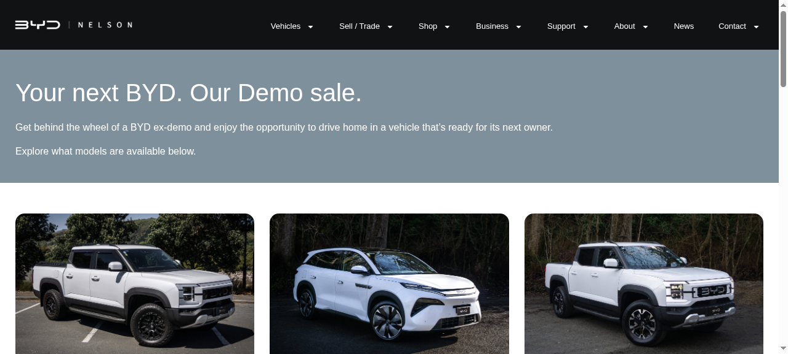

# BYD Nelson — Demo Sale Site Build

A static build of the BYD Nelson Demo Sale site and its supporting pages — 79 pages, all assets mirrored, no external dependencies.

**[→ View the live site](https://ebubechineka.github.io/byd-nelson-clone/)**



## What this is

A static build of the BYD Nelson Demo Sale campaign site, made as a front-end study of how a promotional campaign page is put together: the hero, the offer, the stock list and the enquiry path.

Every page, stylesheet, script, image and font is served from this repository — there are no external dependencies and no redirects to the original site or any third party.

## What's inside

- 79 HTML pages
- 1,684 files, all local
- Zero external dependencies
- Entry point: `byd-nelson_v2/byd-nelson-demo-sale/index.html`

## Technology

- HTML, CSS and JavaScript
- Static site — no build step required
- Deployed on GitHub Pages

## Run it locally

```bash
python3 -m http.server 8000
# then open http://localhost:8000/byd-nelson_v2/byd-nelson-demo-sale/
```

## Note

A front-end study build. All brand marks, imagery and copy belong to BYD and the dealership; the build work is what this repository demonstrates.


---

<sub>Built by **[Benito K Chukwuemeka](https://github.com/Ebubechineka)** · [Golden Vista Global](https://goldenvistaglobal.vercel.app/) — business websites, landing pages and web apps for clients in Nigeria and worldwide.</sub>
